<p align="center">
  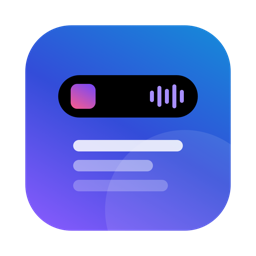
</p>

<h1 align="center">MacIsland</h1>

<p align="center">
  <b>A Dynamic Island for the MacBook notch.</b><br>
  Music, timers, notifications, a smart clipboard with translation, widgets and voice control — right where the camera is.
</p>

<p align="center">
  
  
  
  
  
</p>

<p align="center">
  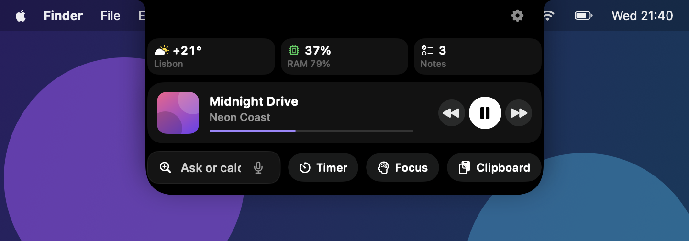
</p>

MacIsland turns the black notch at the top of your MacBook screen into a small live hub. It stays out of
the way as a regular notch, shows what's going on at its sides, and expands into a panel with controls
when you hover over it (or click it, or press <kbd>⌥ Space</kbd>).

It is a native Swift/SwiftUI app with no dependencies — it builds with just the Command Line Tools.

---

## Contents

- [Features](#features)
  - [Compact island and live activities](#compact-island-and-live-activities)
  - [Music and video](#music-and-video)
  - [Voice commands](#voice-commands)
  - [Timers and Pomodoro](#timers-and-pomodoro)
  - [Notifications](#notifications)
  - [Smart Clipboard](#smart-clipboard)
  - [Translate copied text](#translate-copied-text)
  - [Widgets](#widgets)
  - [The “Ask” field](#the-ask-field)
  - [Settings](#settings)
- [Install](#install)
- [Permissions](#permissions)
- [Privacy](#privacy)
- [How it works](#how-it-works)
- [Known limitations](#known-limitations)
- [Roadmap](#roadmap)
- [По-русски](#по-русски)

---

## Features

### Compact island and live activities

When nothing needs your attention, the island is just the notch. When something is happening, it grows
small “wings”: the album cover on the left and a live equalizer, timer or download progress on the right.
Short events — charging, a finished timer, a copied text, a new message — slide out underneath for a
couple of seconds.

<p align="center">
  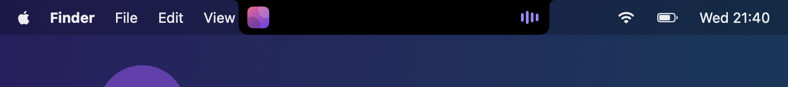<br>
  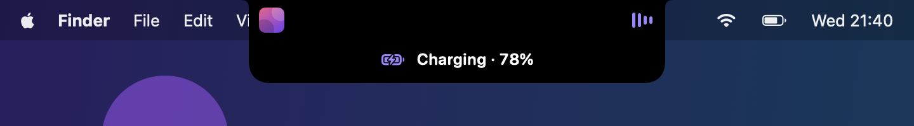
</p>

- The wings hide automatically when an app's menus or menu bar icons get close to the notch, so nothing is covered.
- Battery: alerts when you plug in, unplug, or run low.
- An orange or green dot next to the notch when another app uses the microphone or the camera.
- Downloads from Safari, Chrome, Yandex Browser, Edge, Arc and Firefox: name, percent, speed and time left.

### Music and video

Works with **any player that shows up in Control Center** — Apple Music, Spotify, Yandex Music, YouTube or
any other video in a browser, IINA, VLC and more: cover art, title, artist, live progress, play/pause,
next and previous.

**Music always wins.** If a song is playing and you open a video on top, the island keeps controlling the
music. Videos get the controls only when no music is playing.

**Several players at once?** The card splits in two — video on the left, music on the right — and each
half has its own controls. With a single player, the card uses the full width.

<p align="center">
  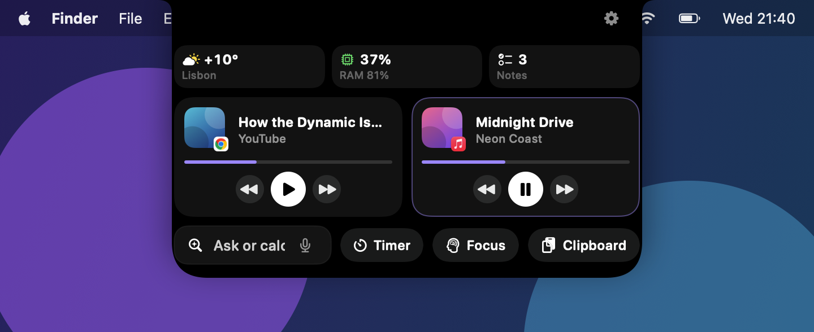
</p>

### Voice commands

Control music and videos without touching the keyboard. MacIsland listens while something is playing or
paused, and reacts only when a command is said **on its own** — a word that happens to be in a song or a
sentence won't skip your track.

| Say (English)               | Say (Russian)                     | What happens                        |
| --------------------------- | --------------------------------- | ----------------------------------- |
| “next”, “next track”, “skip” | «дальше», «следующий трек»        | Next track or video                 |
| “back”, “previous track”    | «назад», «предыдущий трек»        | Previous track or video             |
| “pause”                     | «пауза»                           | Pauses — or resumes if paused       |
| “resume”, “play music”      | «продолжи», «включи музыку»       | Only resumes (does nothing if playing) |
| “stop the music”            | «выключи музыку»                  | Only pauses (never starts playback) |

Speech is recognised **on your Mac** by the speech engine built into macOS — no audio leaves the computer.
macOS shows its orange microphone indicator while MacIsland is listening, and you can turn voice control
off at any time.

### Timers and Pomodoro

<p align="center">
  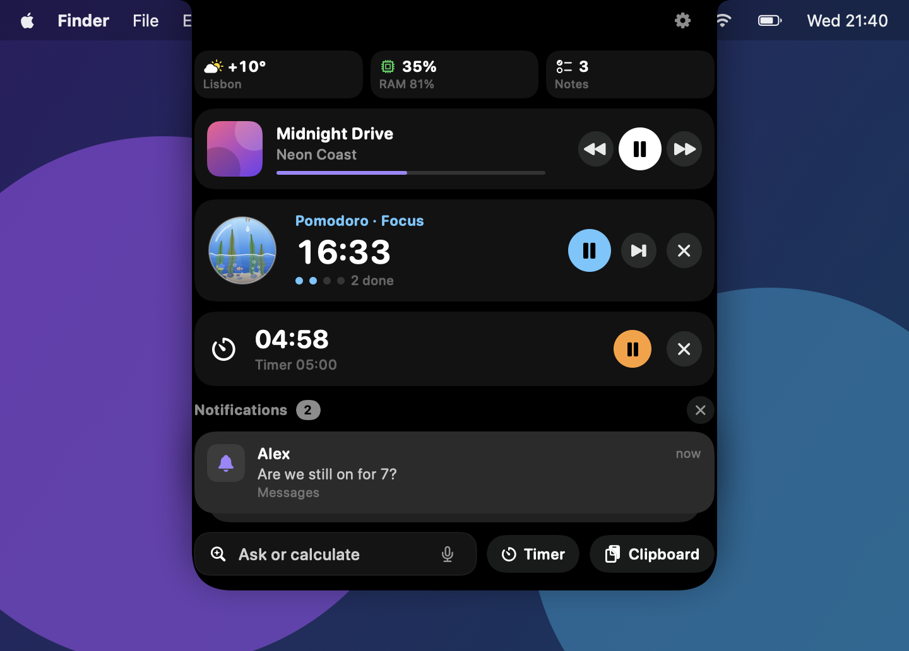
</p>

- **Timers and a stopwatch** — several at once, pause, resume and one-click repeat. Type “5 min”, “1:30”
  or “timer 20” in the island's field, or use the Timer button.
- **Pomodoro** — 25 minutes of focus and 5 of rest, with a long break after every fourth round (all
  adjustable). The phase and finished rounds are always visible, and the timer lives in an animated
  liquid “aquarium” that fills up as you work. You can drop your own picture onto it.

### Notifications

Recent banners from Telegram, Mail, Messages and other apps are collected in the island — read them,
open the app they came from, or clear them. macOS has no official API for this, so MacIsland reads the
system banners through Accessibility; this is optional and off by default.

### Smart Clipboard

<p align="center">
  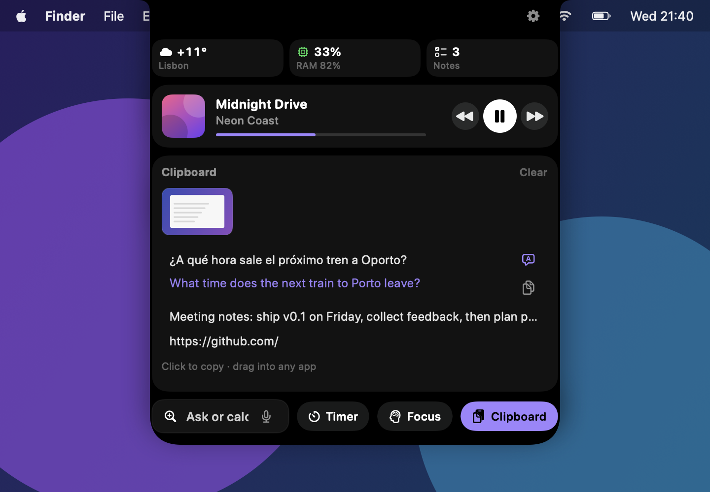
</p>

The island becomes a temporary workspace between apps:

- **Screenshots in one place.** New screenshots appear as thumbnails — drag them straight into Telegram, a browser or an editor.
- **Text history.** Copied snippets are kept as separate items: click to copy again, drag into any app, pin or delete.
- **Translation of anything you copied** — see below.
- **Limits you control** — 10 texts and 5 images by default. The oldest unpinned items go first.
- **Private by design.** Everything is stored only on this Mac; passwords copied from password managers are never saved.

### Translate copied text

Reading something in a foreign language? Copy it, and translate it without leaving the app you're in:

1. Copy the text as usual (<kbd>⌘ C</kbd>).
2. Open the island and press **Clipboard**.
3. Hover the copied item and click the **translate** button next to it (a speech bubble with an “A”).
4. The translation appears right under the original — click the copy button to put it on the clipboard.
   Click translate again to hide it.

- **Language is picked automatically:** text is translated into your system language, and text that's
  already in your language is translated into English. You can choose a fixed target language in
  **Settings → Clipboard & Translation**.
- **Free and offline.** MacIsland uses the translator built into macOS 15+: each language pair downloads
  once (macOS asks the first time), then works without the internet. Nothing is sent to third-party services.
- On macOS 14, the text opens in Google Translate in your browser instead.

### Widgets

A row of small tiles under the notch. Click a tile for details, click again to close.

<table>
  <tr>
    <td>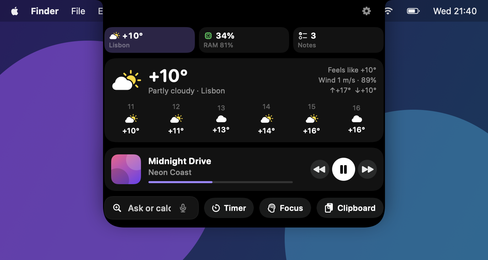</td>
    <td>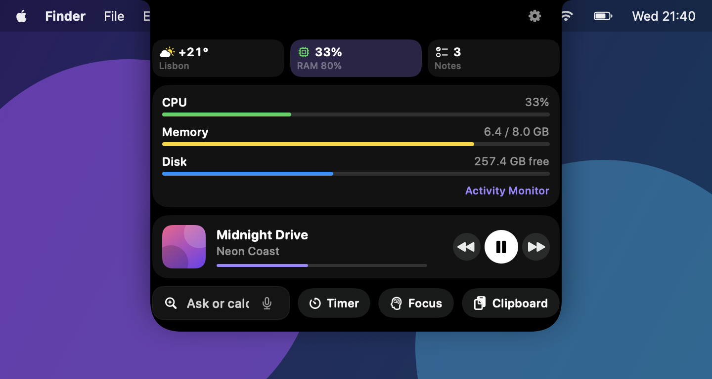</td>
  </tr>
  <tr>
    <td align="center"><b>Weather</b> — current conditions and the next hours for your city (Open-Meteo, no account needed).</td>
    <td align="center"><b>System</b> — CPU, memory and free disk space. Measured only while the island is open.</td>
  </tr>
  <tr>
    <td colspan="2">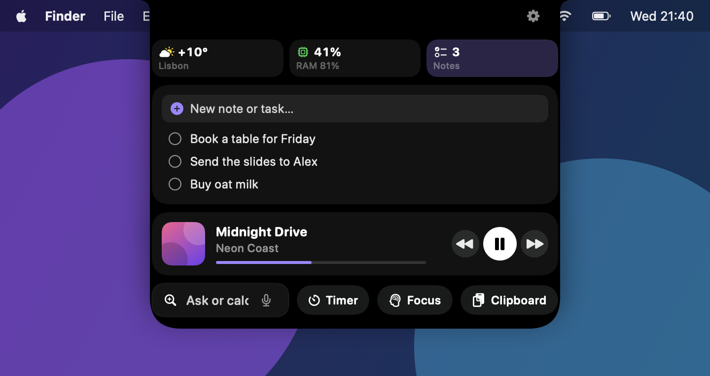</td>
  </tr>
  <tr>
    <td colspan="2" align="center"><b>Notes</b> — quick notes and a to-do list without opening another app.</td>
  </tr>
</table>

### The “Ask” field

One field at the bottom of the island does several things:

- **Calculator** — `12*7`, `(1200-150)/3` and so on, answered as you type.
- **Timers** — “5 min”, “10m”, “1:30”, “90 sec”.
- **Quick launch** — type an app name and the matching apps appear; “Open Telegram” + <kbd>Enter</kbd> launches it.
- **Questions to AI** — answered by **Apple Intelligence** (free and on-device, macOS 26+) or by **your
  own API key** for any OpenAI-compatible service: OpenRouter, OpenAI, Groq, or a local **Ollama**. Without
  any setup, “Ask in browser” opens the question in ChatGPT. You can also ask by voice.

### Settings

<p align="center">
  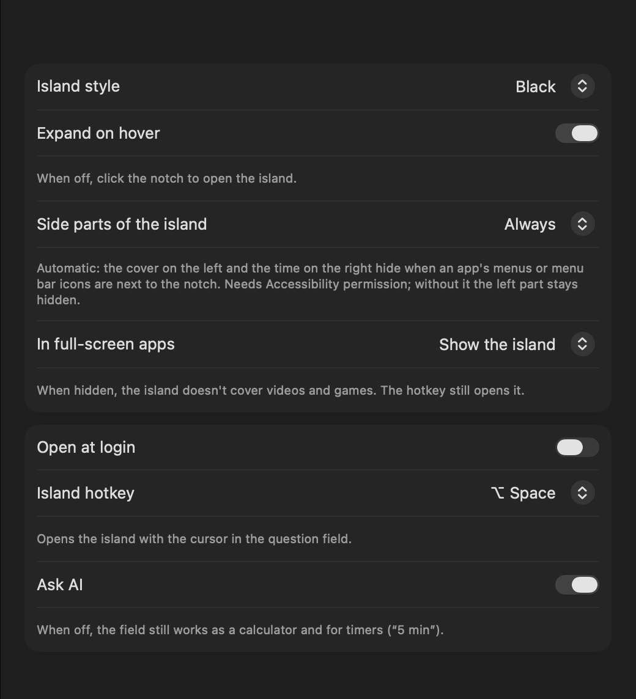
  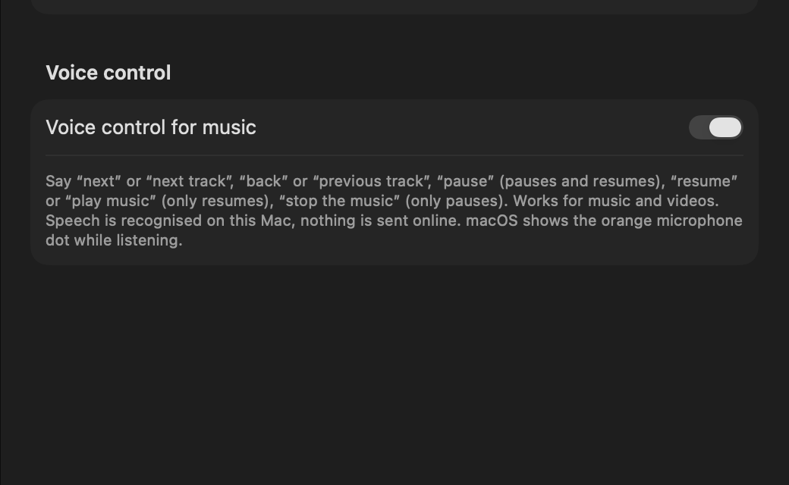
</p>

- Island style: **Liquid Glass** (real on macOS 26, frosted glass on 14–15) or plain **black**.
- Expand on hover or on click; when to show the side parts.
- Hotkey: <kbd>⌥ Space</kbd>, <kbd>⌃⌥ Space</kbd>, <kbd>⌥⇧ Space</kbd> or <kbd>⌘⇧ Space</kbd>.
- **Full-screen apps:** show the island, or hide it so it never covers videos and games (the hotkey still opens it).
- Every module can be turned on or off. Open at login.
- English and Russian interface (follows the system language).

---

## Install

### Download

Grab `MacIsland.zip` from the [latest release](../../releases/latest), unzip it and move
**MacIsland.app** to **Applications**.

The app isn't notarized by Apple, so the first launch needs one extra step: right-click the app →
**Open** → **Open**. (Or open it once, then go to **System Settings → Privacy & Security** and click
**Open Anyway**.)

### Build from source

Only the Command Line Tools are needed — no Xcode project:

```bash
xcode-select --install   # once, if you don't have the tools yet
git clone https://github.com/stepaprohorcuk-bot/MacIsland.git
cd MacIsland
./build.sh install       # builds, copies to /Applications and launches
```

`./build.sh` alone just builds `MacIsland.app` in the project folder.

> **Tip for developers.** macOS ties permissions such as Accessibility to the app's signature. With ad-hoc
> signing every rebuild looks like a new app and the permissions reset. Create a self-signed
> code-signing certificate named **MacIsland Dev** in Keychain Access
> (*Certificate Assistant → Create a Certificate…*, type *Code Signing*), and `build.sh` will use it
> automatically so permissions survive rebuilds.

### Requirements

- A Mac with Apple silicon and macOS 14 Sonoma or later.
- Made for MacBooks with a notch; on other Macs the island sits at the top centre of the screen.

---

## Permissions

MacIsland asks for each permission only when you turn on the feature that needs it.

| Permission | Used for |
| --- | --- |
| **Accessibility** | Hiding the side parts when menus reach the notch, reading notification banners, sending play/pause keys to the right player when music and video play together. |
| **Microphone** and **Speech Recognition** | Voice commands and asking by voice. |
| **Automation** (Spotify, Music) | Controlling Spotify and Apple Music directly when another player holds the system media keys. |
| **Downloads folder** | Showing download progress. |

---

## Privacy

- No analytics, no accounts, no servers of our own.
- Voice is recognised on-device by macOS.
- Clipboard history and notes are stored locally in `~/Library/Application Support/MacIsland`.
- Your AI API key is kept in the macOS Keychain. Questions go only to the AI service you choose.
- Weather requests send only the city name and its coordinates to Open-Meteo.

---

## How it works

```
Sources/
├── App/          entry point, settings model, login item, README screenshot renderer
├── Island/       the notch window, compact and expanded views, cards and widgets
├── Modules/      music, voice commands, timers & Pomodoro, clipboard, translator,
│                 notifications, downloads, battery, system monitor, weather & notes
├── Assistant/    the “Ask” field: calculator, timers, AI, dictation
└── Settings/     the settings window
Helper/
└── NowPlayingHelper.m   bridge to the system “Now Playing” service
```

- **The island** is a borderless, non-activating panel above the menu bar on every Space. It only takes
  mouse events while expanded, so clicks next to the notch keep working.
- **Now Playing.** Since macOS 15.4, third-party apps can't read “Now Playing” directly. MacIsland loads a
  tiny helper library into the system `perl`, which still may talk to the private MediaRemote framework,
  and exchanges JSON lines with it. The helper reports every active player, which is how the island can
  prefer music over video and show both side by side.
- **Controlling the right player.** macOS sends media commands only to the app that started playing last.
  When that isn't the one you want (a paused YouTube tab, say), MacIsland talks to the player directly:
  its own keyboard shortcut for Yandex Music and browsers, AppleScript for Spotify and Apple Music.
- **Screenshots in this README** are rendered by the app itself with demo data:
  `./scripts/readme-shots.sh` (it uses a separate data folder, so your real notes and clipboard stay untouched).

---

## Known limitations

- Reading “Now Playing” and notification banners relies on undocumented macOS behaviour and may break
  after a macOS update.
- Accepting or declining calls from the island isn't possible: FaceTime, Telegram and others don't expose that to other apps.
- AirDrop progress isn't available to third-party apps.
- Apple Intelligence doesn't support every language yet; use your own API key for the rest.

## Roadmap

- [ ] Ongoing calls: app, duration and a button to jump back to the call
- [ ] Plugins: small scripts that add your own tiles and cards (currency rates, CI status, class schedule…)
- [ ] Island transparency and a “reduce animations” option
- [ ] Notarized releases

Ideas and bug reports are welcome in [Issues](../../issues).

---

## По-русски

**MacIsland** — Dynamic Island для чёлки MacBook. Наведи курсор на чёлку (или нажми <kbd>⌥ Space</kbd>),
и она раскроется в маленький пульт:

- **Музыка и видео** из любого плеера (Apple Music, Spotify, Яндекс Музыка, YouTube в браузере…). Музыка
  всегда в приоритете над видео; если играет и то и другое, карточка делится пополам.
- **Голосовые команды:** «дальше» / «следующий трек», «назад» / «предыдущий трек», «пауза», «продолжи» /
  «включи музыку», «выключи музыку». Распознавание — на самом Mac.
- **Таймеры, секундомер и Pomodoro** с анимированным аквариумом.
- **Уведомления**, **батарея**, **загрузки**, индикатор **микрофона и камеры**.
- **Умный буфер обмена:** скриншоты миниатюрами (перетаскиваются в любое приложение), история текста
  и закрепление.
- **Перевод скопированного текста:** скопируй текст, открой «Буфер» в острове и нажми кнопку перевода рядом
  с ним — перевод появится прямо под оригиналом, его можно скопировать. Работает через встроенный переводчик
  macOS (15+), бесплатно и без интернета после загрузки языков.
- **Виджеты:** погода, мониторинг системы, заметки и задачи.
- **Поле «Спросить»:** калькулятор, таймеры, быстрый запуск программ и вопросы нейросети (Apple Intelligence
  или свой ключ API: OpenRouter, OpenAI, Groq, Ollama).
- Интерфейс на русском и английском.

Установка: скачай `MacIsland.zip` из [последнего релиза](../../releases/latest) или собери сам —
`./build.sh install`.

---

## License

[MIT](LICENSE)
